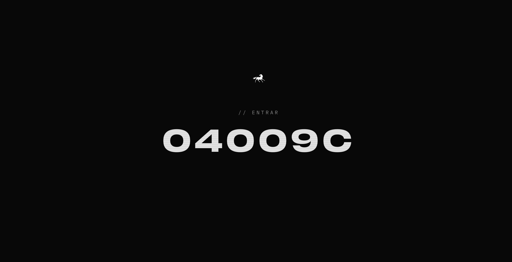
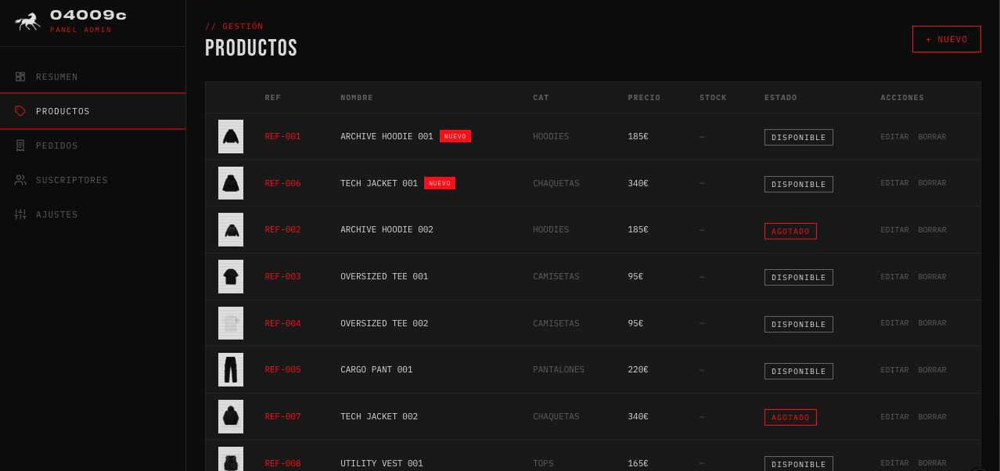

# 04009c · The House of Access

Tienda de ropa exclusiva: catálogo con tallas y stock, carrito, checkout y panel de administración.

**La web es pública: ya no pide clave de acceso.** Se enseña como maqueta completa:
el catálogo es real, el panel es una vista de prueba de solo lectura con datos de
ejemplo y el checkout muestra el pago con Stripe como «próximamente».

La autenticación (acceso de miembro y de administrador) vuelve con **better-auth**.
El código antiguo de sesión con JWT se retiró con la web pública; queda documentado
en [`memory/auth-aparcada.md`](memory/auth-aparcada.md).

En producción: [04009c.vercel.app](https://04009c.vercel.app)





---

## Stack

| Capa | Tecnología |
|---|---|
| Framework | Next.js 16 (App Router, Turbopack) |
| Lenguaje | TypeScript |
| Estilos | Tailwind CSS v4 (tokens en `globals.css`) |
| Animaciones | Framer Motion + View Transitions API |
| Base de datos | MongoDB + Mongoose (Atlas en producción) |
| Auth | Ninguna por ahora (el JWT antiguo se retiró; vuelve con better-auth) |
| Hash de contraseñas | bcryptjs: sin uso en la app, solo en el código aparcado |
| Gráficas | Recharts |
| Tema | next-themes (sigue al sistema) |
| Emails | Nodemailer |
| Deploy | Vercel (push a `main` = producción) |

---

## Arrancar en local

### La maqueta (sin secretos, sin Atlas)

```bash
npm install
npm run demo
```

Levanta un Mongo **en memoria**, siembra los datos de ejemplo, **compila** la maqueta y
la sirve en `http://0.0.0.0:3006`. No hace falta `.env.local`, ni Atlas, ni ninguna clave.
Al cerrar (Ctrl+C) se paran el servidor y el Mongo.

Compila porque `next dev` (Turbopack) en algunos entornos sirve la página pero no hidrata:
React no engancha y lo que va animado se queda invisible. Compilada funciona igual que
en producción, que es lo que se quiere enseñar. El primer arranque tarda un par de minutos.

El Mongo en memoria es una **devDependency** (`mongodb-memory-server`): nunca va
a producción. El binario que descarga se queda en la caché de `node_modules`
y no se commitea.

### Con tu propia base de datos

```bash
npm install
npm run dev
```

MongoDB tiene que estar corriendo en `localhost:27017`. La app queda en `http://localhost:3000`.

`.env.local` apunta a la base de datos de **producción**. Para trabajar en local sin tocar la tienda real, arranca con la base local y sin correo:

```bash
MONGODB_URI="mongodb://localhost:27017/04009c" MAIL_USER="" MAIL_PASS="" npm run dev
```

Si un cambio de estilos no aparece, para el servidor y borra `.next`: con el repo en una carpeta sincronizada por iCloud, Turbopack a veces sirve CSS antigua.

---

## Variables de entorno (`.env.local`)

```env
MONGODB_URI=mongodb://localhost:27017/04009c
MAIL_USER=
MAIL_PASS=
```

Las que hacen falta ahora mismo son `MONGODB_URI` (la base de datos) y, si se quiere
enviar correos, `MAIL_USER` y `MAIL_PASS`. Sin correo, la web funciona igual.

**Sin `MONGODB_URI` la app falla al arrancar**, y es lo correcto: si producción
se quedara sin base de datos y saltyera con datos falsos, sería peor que un error.
Los datos de ejemplo entran solo por `npm run demo`.

### Variables retiradas

`JWT_SECRET_MEMBER` y `JWT_SECRET_ADMIN` **ya no existen en producción ni en el código**.
Se quitaron de Vercel al desmontar la clave de acceso y el login del panel. El código que
las leía se retiró en el mismo cambio. Volverán con better-auth, con su propio secreto.

```env
# JWT_SECRET_MEMBER  → retirada
# JWT_SECRET_ADMIN   → retirada
```

---

## Zonas de la app

### Entrada `/` (pública)
- Audio ambiente en bucle con botón de silencio
- Caballo → `/about` · ADMINISTRADOR (esquina) → panel de prueba
- El número `04009c` es el control de entrada: al pulsarlo aparece el botón **ACCEDER** → `/store`
- Sin clave, sin cookie y sin llamada a la API

### About `/about` y Solicitar acceso `/subscribe`
- Manifiesto de la marca
- `/subscribe`: el formulario está **desactivado** mientras la web es una maqueta. Muestra un aviso «próximamente» con el tono de la casa; no hay campos ni envío a la API

### Tienda `/store` (pública)
- Cabecera: caballo → about, `04009c` → inicio, modos AUTO / AZUL / NEGRO, carrito, administrador. En móvil, menú lateral
- Categorías gestionables desde el panel. TODO y NUEVOS son automáticas (NUEVOS = creados en los últimos 30 días, con etiqueta en la card)
- Fotos con tratamiento común (encuadre, fondo claro, blanco y negro) y segunda foto en hover
- Ficha: tallas S a XL (o talla única) con stock, guía de medidas, cantidad limitada por stock
- Carrito lateral guardado en el navegador, sin superar el stock de cada talla
- Checkout `/store/checkout` con datos de envío, método de envío y resumen. Si el carrito está vacío se enseña un carrito de ejemplo. El pago muestra «Pago con Stripe — próximamente» y no guarda ningún pedido
- Pie con ayuda, legal (páginas pendientes de contenido), redes y cierre de sesión

### Panel `/admin` (vista de prueba, sin contraseña)
Entra directo, sin login. Todos los datos son **inventados** (`src/lib/demo-data.ts`):
correos con dominio de ejemplo, nombres y direcciones ficticios. Así se ve la idea
completa del panel sin exponer datos reales de clientes.

- Banner fijo en todas las pantallas: «Vista de prueba — datos de ejemplo, no se puede modificar nada»
- **Resumen:** métricas y gráficas (ingresos por mes, pedidos por estado, productos por categoría, últimos suscriptores)
- **Productos:** listado con stock por talla, miniatura y etiqueta NUEVO (sin alta, sin edición, sin borrado)
- **Pedidos:** detalle desplegable con artículos, talla, datos de envío e historial de estados (el estado no se puede cambiar)
- **Suscriptores:** tabla y exportación a CSV
- **Ajustes:** categorías, métodos y precios de envío y tablas de medidas, todo en lectura
- Bloqueo de escrituras en los dos lados: en cliente no hay botones de añadir, editar, borrar ni guardar; en servidor `/api/admin/*` solo admite `GET` y el resto responde `405`
- Barra lateral fija en escritorio, menú lateral en móvil

---

## Estructura

```
src/
├── app/
│   ├── page.tsx                  → Portada pública (número → ACCEDER → /store)
│   ├── about/  subscribe/
│   ├── store/                    → Catálogo (público)
│   │   ├── [slug]/               → Ficha de producto
│   │   └── checkout/             → Checkout de ejemplo, pago Stripe «próximamente»
│   ├── admin/                    → Panel de prueba: products, orders, subscribers, settings
│   └── api/
│       ├── products/             → catálogo (público)
│       ├── categories/  store-settings/   → lectura pública (sin datos sensibles)
│       └── admin/                → solo GET con datos de ejemplo; el resto, 405
├── components/
│   ├── gate/  store/  store/cart/  store/checkout/  admin/  admin/charts/  shared/
├── lib/
│   ├── db/  models/             → conexión y modelos: product, order, category, store-settings, subscriber
│   ├── cart-store.ts             → carrito (localStorage)
│   ├── demo-data.ts              → datos INVENTADOS del panel de prueba
│   ├── stock.ts  size-guide.ts  shipping.ts  new-products.ts
│   └── store-config.ts           → categorías y ajustes, con valores iniciales si no existen
└── proxy.ts                      → hoy no bloquea nada; aquí vuelve better-auth

scripts/
└── demo.mjs                      → npm run demo: Mongo en memoria + siembra + Next en 3006
```

---

## Sistema de diseño

Referencia completa en [`DESIGN.md`](DESIGN.md).

| Token | Valor | Uso |
|---|---|---|
| `brand-blue` | `#04009c` | Fondo del modo azul |
| `black` | `#080808` | Fondo del modo negro |
| `brand-red` | `#FF0000` | Acento: acciones, etiquetas, precios, activo, errores |
| `off-white` | `#E2E2E2` | Texto principal y botón primario |
| `surface` / `border` / `dim` | `#1A1A1A` / `#2A2A2A` / `#6B6B6B` | Paneles, separadores, texto secundario |

- Tipografías: cyGrotesk (solo `04009c`), IBM Plex Mono (interfaz), Bebas Neue (títulos), DM Sans (párrafos)
- Sin `border-radius` ni sombras
- El tema sigue al sistema (claro = azul, oscuro = negro) con selector manual
- Alturas con `dvh` y campos a 16 px en móvil para Safari y Chrome
- Curvas de animación propias (`--motion-ease-*`) y respeto a "reducir movimiento"

---

## Pendiente

- [ ] Stripe: pagos reales y creación de pedidos (el modelo de pedido ya guarda talla, envío e historial)
- [ ] Publicar la maqueta (hoy `npm run demo` solo funciona en local)
- [ ] Autenticación con better-auth: clave de acceso y login del panel, de cero (el JWT antiguo se retiró)
- [ ] Subida de fotos (Cloudinary o Vercel Blob): el botón está en el panel, desactivado
- [ ] Fotos propias de la marca: las actuales son de prueba
- [ ] Textos de envíos, devoluciones, guía de tallas y legales
- [ ] Medidas y precios de envío reales (ahora solo lectura en el panel de prueba)
- [ ] Dominio propio
